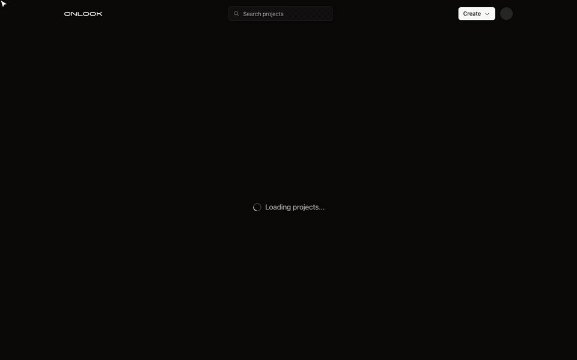
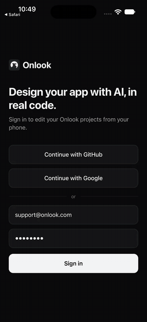

<!-- Improved compatibility of back to top link: See: https://github.com/othneildrew/Best-README-Template/pull/73 -->

<div align="center">

<h3 align="center">Onlook</h3>
  <p align="center">
    <strong>The design tool for AI-native designers — now in early access.</strong>
    <br />
    Onlook makes designing on top of your codebase effortless. Craft exceptional experiences with AI in code.
    <br />
    <br />
    <a href="https://www.onlook.com/waitlist?utm_source=github&utm_medium=readme&utm_campaign=waitlist-2026"><strong>→ Join the waitlist</strong></a>
  </p>
  <p align="center">
    👨‍💻👩‍💻👨‍💻
    <a href="https://www.ycombinator.com/companies/onlook/jobs/e4gHv1n-founding-engineer-fullstack">We're hiring engineers in SF!</a>
    👩‍💻👨‍💻👩‍💻
  </p>
    <br />
    <a href="https://youtu.be/RSX_3EaO5eU?feature=shared">View Demo</a>
    ·
    <a href="https://github.com/onlook-dev/onlook/issues/new?labels=bug&template=bug-report---.md">Report Bug</a>
    ·
    <a href="https://github.com/onlook-dev/onlook/issues/new?labels=enhancement&template=feature-request---.md">Request Feature</a>
  </p>
  <!-- PROJECT SHIELDS -->
<!--
*** I'm using markdown "reference style" links for readability.
*** Reference links are enclosed in brackets [ ] instead of parentheses ( ).
*** See the bottom of this document for the declaration of the reference variables
*** for contributors-url, forks-url, etc. This is an optional, concise syntax you may use.
*** https://www.markdownguide.org/basic-syntax/#reference-style-links
-->
<!-- [![Contributors][contributors-shield]][contributors-url]
[![Forks][forks-shield]][forks-url]
[![Stargazers][stars-shield]][stars-url]
[![Issues][issues-shield]][issues-url]
[![Apache License][license-shield]][license-url] -->

[![Discord][discord-shield]][discord-url]
[![LinkedIn][linkedin-shield]][linkedin-url]
[![Twitter][twitter-shield]][twitter-url]

[中文](https://www.readme-i18n.com/onlook-dev/onlook?lang=zh) |
[Español](https://www.readme-i18n.com/onlook-dev/onlook?lang=es) |
[Deutsch](https://www.readme-i18n.com/onlook-dev/onlook?lang=de) |
[français](https://www.readme-i18n.com/onlook-dev/onlook?lang=fr) |
[Português](https://www.readme-i18n.com/onlook-dev/onlook?lang=pt) |
[Русский](https://www.readme-i18n.com/onlook-dev/onlook?lang=ru) |
[日本語](https://www.readme-i18n.com/onlook-dev/onlook?lang=ja) |
[한국어](https://www.readme-i18n.com/onlook-dev/onlook?lang=ko)

</div>

> This is the open-source visual editor that started Onlook (Next.js + Tailwind). The hosted product we're building next, for AI-native designers, is in early access via the [waitlist](https://www.onlook.com/waitlist?utm_source=github&utm_medium=readme&utm_campaign=waitlist-2026) above.


> **This fork adds iOS and Android apps.** Onlook can now create and edit React Native apps built with Expo, show them in iPhone and Android frames, and open them on a real phone through Expo Go. It also adds local sandboxes, so the whole thing runs on your machine without a CodeSandbox account. There is also an Onlook app for iOS and Android, so you can edit your projects from your phone. See [iOS and Android apps](#ios-and-android-apps-expo) and [The Onlook app](#the-onlook-app-iphone-and-android) below.

## iOS and Android apps (Expo)

<p align="center">
  
  <br>
  <a href="assets/mobile/onlook-mobile-demo.mp4">Watch the full demo (MP4, 64 s)</a>
</p>

Pick **Create → Mobile App (iOS & Android)** on the projects page. Onlook starts an Expo app (Expo Router, NativeWind, TypeScript) and opens it in two frames, an iPhone 16 Pro and a Pixel 9, rendered with React Native Web.

From there the editor works the way it does for Next.js:

- Click any `View`, `Text` or `Pressable` to select it. Typography, spacing, radius, colors and layout edits are written back to the component's `className` as NativeWind classes.
- The code panel jumps to the selected element in `src/app/*.tsx`.
- Expo Router screens show up in the Pages panel (`index`, `profile`, `(tabs)/…`), and you can open them in any frame.
- The Brand panel reads the project's Tailwind palette, including NativeWind's `global.css`.
- **Run on device** in the top bar shows a QR code. Scan it with Expo Go on iOS or Android to run the app natively, and changes you make in Onlook reload on the phone.

Existing Expo projects that use Expo Router and NativeWind work too. With local sandboxes on, import one from GitHub: Onlook detects Expo from `package.json`, starts it with `expo start`, finds the `app/_layout.tsx` root and adds its two bridge files (see below). On CodeSandbox, GitHub imports still assume a Next.js app on port 3000.

### Run it locally

Phones and simulators need to reach the dev server, so mobile projects run best in a local sandbox: a folder on your machine that the Onlook server manages for you.

```bash
bun install
cd apps/backend && supabase start && cd ../..   # local Supabase
bun run db:push && bun run db:seed

# apps/web/client/.env: the usual Supabase keys, plus
ONLOOK_LOCAL_SANDBOXES=true
# optional, defaults to ~/.onlook/sandboxes
ONLOOK_LOCAL_SANDBOX_DIR=/path/to/sandboxes

bun run dev
```

Sign in with the dev login, then create a mobile app. The first start runs `bun install` and `expo start --web --lan` in the sandbox, which takes about ten seconds once Bun's cache is warm.

Local sandboxes run commands on your machine. They are off unless `ONLOOK_LOCAL_SANDBOXES=true`. Every request must come from a signed-in user who has access to that project. Processes get a minimal environment (`PATH`, `HOME` and similar), never the Onlook server's secrets.

With CodeSandbox (the default, `ONLOOK_LOCAL_SANDBOXES` unset), the mobile template is cloned from the `template-expo` branch of this repository and served on port 8081. The canvas works the same way. Expo Go can't reach a cloud sandbox directly, though, so run `npx expo start --tunnel` in the terminal for a phone preview.

### How it works

| Piece | Where | What it does |
| --- | --- | --- |
| Expo template | `templates/expo/` | Expo Router + NativeWind + React Native Web starter, published to the `template-expo` branch |
| Router detection | `pages/helper.ts`, `RouterType.EXPO` | Treats `app/_layout.tsx` or `src/app/_layout.tsx` as an Expo Router root and scans screens as pages |
| Babel plugin | `onlook/babel-plugin-react-native.js` | React Native Web drops unknown props, so `data-oid="…"` becomes `dataSet={{ oid: "…" }}`, which it renders as `data-oid`. Native builds ignore it |
| Preload bridge | `onlook/preload.js` | Imported by the root `_layout`. On web, inside the Onlook iframe only, it loads the editor script. Elsewhere it does nothing |
| Local provider | `packages/code-provider/src/providers/local`, `apps/web/client/src/server/local-sandbox` | Implements the `Provider` interface over `/api/local-sandbox`: file operations as JSON, dev server, terminal output and file changes over server-sent events |
| Phone frames | `DefaultNativeFrames` | New Expo projects start with an iPhone 16 Pro and a Pixel 9 frame |
| Run on device | `top-bar/run-on-device.tsx` | `exp://<LAN IP>:<port>` QR code for Expo Go |

### Known limits

- The canvas shows the React Native Web rendering. It matches iOS and Android closely for layout and styling, but native-only modules (camera, maps, haptics) need Expo Go or a simulator.
- Styling goes through NativeWind classes. Projects that style only with `StyleSheet.create` can still be selected and edited in code, but toolbar edits add classes rather than rewriting style objects.
- Font management (`next/font`) is turned off for Expo projects.
- Inline text editing works the same as on web projects. Double-clicking opens the element in the code panel.

## The Onlook app (iPhone and Android)

<p align="center">
  
  <br>
  <a href="assets/mobile/onlook-app-demo.mp4">Watch the full demo (MP4, 54 s)</a>
</p>

`mobile/` is an Expo app that brings the editor to your phone. Sign in with GitHub, Google or email, and you get your projects list. From there you can:

- Start a project: an iOS and Android app (Expo) or a website (Next.js), with an optional prompt for the AI.
- Open any project in the editor's phone layout. One frame fills the screen. Drag to pan, pinch to zoom, tap an element to select it.
- Edit the selected element with the style toolbar above the tab bar. It scrolls sideways and covers the same controls as on desktop (colors, spacing, radius, layout, typography). Changes are written to the code like they are on the web.
- Switch to Chat, Pages or Layers from the tab bar, and step through the project's frames with the `1/2` button.
- Long-press a project to delete it.

The app signs in natively, then opens the web editor in a WebView and hands it the session once (`/auth/mobile`). API calls from the app use the Supabase access token as a bearer token, which `createTRPCContext` accepts alongside cookies. The same phone layout shows up in a mobile browser too, on any screen narrower than 768px.

### Run it

Start Onlook as described in [Run it locally](#run-it-locally), then:

```bash
cd mobile
cp .env.example .env.local   # point it at your Onlook server and Supabase project
bun install
bun run ios       # or: bun run android
```

`EXPO_PUBLIC_ONLOOK_URL` has to be reachable from the phone or simulator. `localhost` works in the iOS simulator. On an Android emulator, run `adb reverse tcp:3000 tcp:3000` (with your Onlook port). On a real phone, use your computer's LAN address. The app runs in Expo Go, no native build needed.

### Known limits

- The editor needs a few seconds after the frame appears before taps select elements, while it connects to the frame.
- In production builds, frames load Onlook's preload script from the jsDelivr CDN, pinned to an upstream commit (`ONLOOK_PROD_PRELOAD_SCRIPT_SRC` in `packages/constants/src/files.ts`). That build predates the WebKit fix for reading computed styles, so on iOS the toolbar shows default values (16px, Regular) for the selected element until the pin points to a commit that includes it. Development builds serve the script from `apps/web/client/public` and aren't affected.

# An Open-Source, Visual-First Code Editor

Craft websites, prototypes, and designs with AI in Next.js + TailwindCSS. Make
edits directly in the browser DOM with a visual editor. Design in realtime with
code. An open-source alternative to Bolt.new, Lovable, V0, Replit Agent, Figma
Make, Webflow, etc.


## What you can do with Onlook:

- [x] Create Next.js app in seconds
  - [x] Start from text or image
  - [x] Use prebuilt templates
- [x] Create iOS and Android apps (Expo + NativeWind)
  - [x] Edit in iPhone and Android frames
  - [x] Expo Router screens as pages
  - [x] Run on a real device with Expo Go
  - [x] Run sandboxes locally
- [x] Visually edit your app
  - [x] Use Figma-like UI
  - [x] Preview your app in real-time
  - [x] Manage brand assets and tokens
  - [x] Create and navigate to Pages
  - [x] Browse layers
  - [x] Manage project Images
  - [x] Detect and use Components – _Previously in
        [Onlook Desktop](https://github.com/onlook-dev/desktop)_
  - [ ] Drag-and-drop Components Panel
  - [x] Use Branching to experiment with designs
- [x] Development Tools
  - [x] Real-time code editor
  - [x] Save and restore from checkpoints
  - [x] Run commands via CLI
  - [x] Connect with app marketplace
- [x] Deploy your app in seconds
  - [x] Generate sharable links
  - [x] Link your custom domain    
- [ ] Collaborate with your team
  - [x] Real-time editing
  - [ ] Leave comments
- [ ] Advanced AI capabilities
  - [x] Queue multiple messages at once
  - [ ] Use Images as references and as assets in a project
  - [ ] Setup and use MCPs in projects
  - [ ] Allow Onlook to use itself as a toolcall for branch creation and iteration
- [ ] Advanced project support
  - [x] Support React Native (Expo) projects
  - [ ] Support other non-NextJS projects
  - [ ] Support non-Tailwind projects


## Getting Started

Use our [hosted app](https://onlook.com) or
[run locally](https://docs.onlook.com/developers/running-locally).

### Usage

Onlook will run on any Next.js + TailwindCSS project, or any Expo Router +
NativeWind app. Import your project into Onlook or start from scratch within the
editor.

Use the AI chat to create or edit a project you're working on. At any time, you
can always right-click an element to open up the exact location of the element
in code.


<br>

Draw-in new divs and re-arrange them within their parent containers by
dragging-and-dropping.


<br>

Preview the code side-by-side with your site design.


<br>

Use Onlook's editor toolbar to adjust Tailwind styles, directly manipulate
objects, and experiment with layouts.


## Documentation

For full documentation, visit [docs.onlook.com](https://docs.onlook.com)

To see how to Contribute, visit
[Contributing to Onlook](https://docs.onlook.com/developers) in our docs.

## How it works


1. When you create an app, we load the code into a web container
2. The container runs and serves the code
3. Our editor receives the preview link and displays it in an iFrame
4. Our editor reads and indexes the code from the container
5. We instrument the code in order to map elements to their place in code
6. When the element is edited, we edit the element in our iFrame, then in code
7. Our AI chat also has code access and tools to understand and edit the code

This architecture can theoretically scale to any language or framework that
displays DOM elements declaratively (e.g. jsx/tsx/html). We are focused on
making it work well with Next.js and TailwindCSS for now.

For a full walkthrough, check out our
[Architecture Docs](https://docs.onlook.com/developers/architecture).

### Our Tech Stack

#### Front-end

- [Next.js](https://nextjs.org/) - Full stack
- [TailwindCSS](https://tailwindcss.com/) - Styling
- [tRPC](https://trpc.io/) - Server interface

#### Database

- [Supabase](https://supabase.com/) - Auth, Database, Storage
- [Drizzle](https://orm.drizzle.team/) - ORM

#### AI

- [AI SDK](https://ai-sdk.dev/) - LLM client
- [OpenRouter](https://openrouter.ai/) - LLM model provider
- [Morph Fast Apply](https://morphllm.com) - Fast apply model provider
- [Relace](https://relace.ai) - Fast apply model provider

#### Sandbox and hosting

- [CodeSandboxSDK](https://codesandbox.io/docs/sdk) - Dev sandbox
- Local sandboxes - Dev sandbox on your own machine (`ONLOOK_LOCAL_SANDBOXES=true`)
- [Freestyle](https://www.freestyle.sh/) - Hosting

#### Runtime

- [Bun](https://bun.sh/) - Monorepo, runtime, bundler
- [Expo](https://expo.dev/) + [NativeWind](https://www.nativewind.dev/) - iOS and Android apps
- [Docker](https://www.docker.com/) - Container management

## Contributing


If you have a suggestion that would make this better, please fork the repo and
create a pull request. You can also
[open issues](https://github.com/onlook-dev/onlook/issues).

See the [CONTRIBUTING.md](CONTRIBUTING.md) for instructions and code of conduct.

#### Contributors

<a href="https://github.com/onlook-dev/onlook/graphs/contributors">
  
</a>

## Contact


- Team: [Discord](https://discord.gg/hERDfFZCsH) -
  [Twitter](https://twitter.com/onlookdev) -
  [LinkedIn](https://www.linkedin.com/company/onlook-dev/) -
  [Email](mailto:contact@onlook.com) - [YouTube](https://youtube.com/@onlookdev)
- Project:
  [https://github.com/onlook-dev/onlook](https://github.com/onlook-dev/onlook)
- Website: [https://onlook.com](https://onlook.com/?utm_source=github&utm_medium=readme&utm_campaign=waitlist-2026)

## License

Distributed under the Apache 2.0 License. See [LICENSE.md](LICENSE.md) for more
information.

<!-- https://www.markdownguide.org/basic-syntax/#reference-style-links -->

[contributors-shield]: https://img.shields.io/github/contributors/onlook-dev/studio.svg?style=for-the-badge
[contributors-url]: https://github.com/onlook-dev/onlook/graphs/contributors
[forks-shield]: https://img.shields.io/github/forks/onlook-dev/studio.svg?style=for-the-badge
[forks-url]: https://github.com/onlook-dev/onlook/network/members
[stars-shield]: https://img.shields.io/github/stars/onlook-dev/studio.svg?style=for-the-badge
[stars-url]: https://github.com/onlook-dev/onlook/stargazers
[issues-shield]: https://img.shields.io/github/issues/onlook-dev/studio.svg?style=for-the-badge
[issues-url]: https://github.com/onlook-dev/onlook/issues
[license-shield]: https://img.shields.io/github/license/onlook-dev/studio.svg?style=for-the-badge
[license-url]: https://github.com/onlook-dev/onlook/blob/master/LICENSE.txt
[linkedin-shield]: https://img.shields.io/badge/-LinkedIn-black.svg?logo=linkedin&colorB=555
[linkedin-url]: https://www.linkedin.com/company/onlook-dev
[twitter-shield]: https://img.shields.io/badge/-Twitter-black?logo=x&colorB=555
[twitter-url]: https://x.com/onlookdev
[discord-shield]: https://img.shields.io/badge/-Discord-black?logo=discord&colorB=555
[discord-url]: https://discord.gg/hERDfFZCsH
[React.js]: https://img.shields.io/badge/react-%2320232a.svg?logo=react&logoColor=%2361DAFB
[React-url]: https://reactjs.org/
[TailwindCSS]: https://img.shields.io/badge/tailwindcss-%2338B2AC.svg?logo=tailwind-css&logoColor=white
[Tailwind-url]: https://tailwindcss.com/
[Electron.js]: https://img.shields.io/badge/Electron-191970?logo=Electron&logoColor=white
[Electron-url]: https://www.electronjs.org/
[Vite.js]: https://img.shields.io/badge/vite-%23646CFF.svg?logo=vite&logoColor=white
[Vite-url]: https://vitejs.dev/
[product-screenshot]: assets/brand.png
[weave-shield]: https://img.shields.io/endpoint?url=https%3A%2F%2Fapp.workweave.ai%2Fapi%2Frepository%2Fbadge%2Forg_pWcXBHJo3Li2Te2Y4WkCPA33%2F820087727&cacheSeconds=3600&labelColor=#131313
[weave-url]: https://app.workweave.ai/reports/repository/org_pWcXBHJo3Li2Te2Y4WkCPA33/820087727
